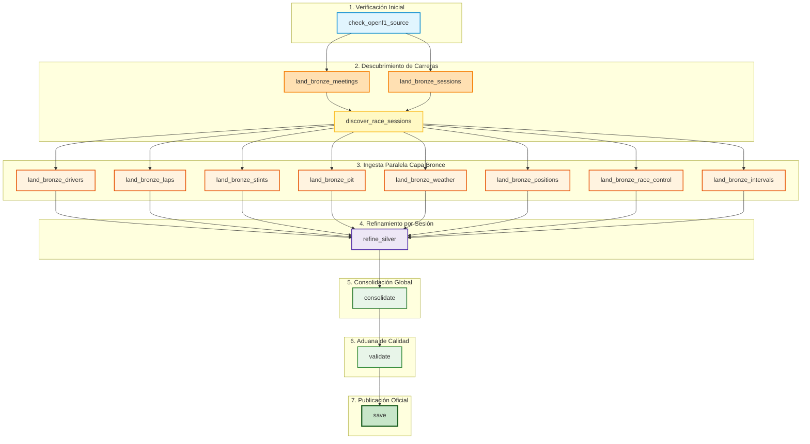

# 🏎️ GUÍA DEFINITIVA PARA LA DEFENSA ORAL – ENTREGA 1 (CIENCIA DE DATOS)
> **Materia:** Ciencia de Datos – Ingeniería en Sistemas de Información (UTN FRM)  
> **Proyecto:** Pipeline de Datos para Estrategia de Neumáticos en Fórmula 1 (`f1-strategy-pipeline`)  
> **Fase del Proyecto:** **Entrega 1: Data Engineering & DataOps Pipeline** (Extracción, Limpieza, Consolidación y Validación).  
> *Nota clave:* Aún **NO** incluye análisis exploratorio avanzado, visualización ni modelos de Machine Learning (eso corresponde a las Entregas 2 y 3).

---

## 🎯 1. La Pregunta del Negocio (El Corazón del Proyecto)

Toda decisión técnica en este pipeline responde exclusivamente a esta pregunta de investigación:

> **«¿Conviene ir a boxes a cambiar el compuesto de neumático en determinada vuelta, dadas las condiciones de carrera, el circuito y el estado actual de los neumáticos de una carrera de Fórmula 1? ¿A qué compuesto de neumáticos conviene cambiar?»**

### ¿Por qué esta pregunta define la arquitectura de datos?
Para responder si un piloto debe parar en boxes en la vuelta $N$, un modelo de Machine Learning necesitará saber en el futuro:
1. **El estado del neumático:** ¿Cuántas vueltas de uso tiene (`tyre_age_laps`)? ¿Qué compuesto calza actualmente (`compound`: SOFT, MEDIUM, HARD, INTERMEDIATE, WET)? ¿En qué tanda de carrera está (`stint_number`)?
2. **El rendimiento de la vuelta:** ¿Se está degradando el tiempo de vuelta (`lap_duration`)? ¿Cae la velocidad en las rectas o sectores (`st_speed`, `i1_speed`)?
3. **El contexto competitivo:** ¿En qué posición está (`position`)? ¿A cuánto está del líder o del perseguidor (`gap_to_leader`, `interval`)?
4. **Las condiciones externas imprevistas:** ¿Entró un Safety Car o Virtual Safety Car (`safety_car_active`, `virtual_safety_car_active`) que abarata el tiempo perdido en boxes? ¿Hay bandera amarilla o lluvia inminente (`air_temperature`, `track_temperature`, `rainfall`)?

---

## ⏱️ 2. El Cronómetro de los 20 Minutos (Estructura de la Exposición)

La cátedra divide los 20 minutos de evaluación en 5 bloques estrictos:

| Minutos | Bloque | Qué sucede | Quién actúa |
|---|---|---|---|
| **0 – 2** | **De qué se trata** | 3 oraciones clave: Pregunta, Fuente y Unidad de Análisis. | Grupo |
| **2 – 7** | **La corrida en Airflow** | Mostrar el grafo en verde, explicando **qué hace cada tarea** y por qué está ahí. | Grupo |
| **7 – 12** | **El Dataset (CSV)** | Abrir el CSV y defender los **7 criterios de calidad** con números exactos en mano. | Grupo |
| **12 – 18** | **Preguntas dirigidas** | El docente interroga a integrantes puntuales sobre cualquier tarea o decisión. | Individual |
| **18 – 20** | **Devolución** | Nota y feedback de la cátedra para la Entrega 2. | Docente |

---

## 🎤 3. Minuto 0 a 2: La Apertura Perfecta (Las 3 Oraciones Clave)

Cuando el docente diga «adelante», no abras filminas ni des rodeos teóricos. Di con seguridad:

1. **La Pregunta:**  
   *«Nuestro proyecto busca predecir y evaluar si a un piloto de Fórmula 1 le conviene entrar a boxes a cambiar neumáticos en una vuelta dada según la degradación del neumático, el ritmo de carrera, el clima y los incidentes en pista, y a qué compuesto le conviene cambiar.»*
2. **La Fuente:**  
   *«La fuente de datos es la API pública oficial de telemetría de OpenF1, de la cual consumimos 10 endpoints complementarios que abarcan carreras de la temporada 2024.»*
3. **La Unidad de Análisis:**  
   *«Nuestra unidad de análisis es: **Una fila representa una vuelta completada o intentada por un piloto en un Gran Premio de Fórmula 1.**»*

---

## 🕸️ 4. Minuto 2 a 7: Recorrido del Grafo de Airflow (Tarea por Tarea)

Muestras en la pantalla la interfaz web de Airflow (`localhost:15539` o `localhost:8080`), vas a la pestaña **Graph** del DAG `f1_strategy_pipeline` con todas las tareas en **verde (`success`)**, y explicas el flujo en orden:



---

### Explicación detallada de CADA una de las 16 tareas:

#### 1. `check_openf1_source`
- **Qué hace:** Envía una solicitud HTTP `HEAD/GET` liviana al endpoint `/sessions` de OpenF1.
- **Por qué está ahí:** Aplica el principio **Fail-Fast** (fallar rápido). Si la API externa está caída o no hay conexión a internet, el pipeline se detiene en el segundo 1, evitando malgastar recursos o generar corridas corruptas.

#### 2. `land_bronze_meetings`
- **Qué hace:** Descarga el listado de eventos/circuitos del año 2024 (los 24 Grandes Premios) y los guarda crudos en `include/output/bronze/season=2024/meetings.json`.
- **Por qué está ahí:** Proporciona los metadatos del circuito (nombre oficial, país, ubicación) necesarios para contextualizar cada carrera.

#### 3. `land_bronze_sessions`
- **Qué hace:** Descarga todas las sesiones del año 2024 (prácticas libres, clasificaciones, sprint y carreras de domingo) en `sessions.json`.
- **Por qué está ahí:** En un fin de semana de F1 hay entre 3 y 5 sesiones; necesitamos el inventario completo para poder discernir cuáles son carreras reales.

#### 4. `discover_race_sessions`
- **Qué hace:** Inspecciona `sessions.json` y filtra únicamente las sesiones cuyo `session_name == "Race"` (excluyendo prácticas P1/P2/P3 y Qualy).
- **Por qué está ahí:** Centraliza la lógica de selección de objetivos y retorna la lista de `session_key` de las carreras a procesar, coordinando la ejecución de las tareas posteriores.

#### 5 a 12. Tareas de Ingesta Paralela Bronce (`land_bronze_*`)
Cada una de estas 8 tareas descarga una dimensión específica para las carreras seleccionadas y la almacena en formato JSON inmutable sin transformar:
- **`land_bronze_drivers`:** Información de los 20+ pilotos (número, código, nombre, equipo).
- **`land_bronze_laps`:** Datos base de vueltas (tiempos de vuelta, timestamps de inicio/fin, velocidades máximas). Es la columna vertebral del dataset.
- **`land_bronze_stints`:** Ciclos de vida del neumático (compuesto montado: SOFT/MEDIUM/HARD, vuelta de inicio, vuelta de fin, si era neumático nuevo o usado).
- **`land_bronze_pit`:** Paradas en boxes registradas (duración total en el carril de pits, duración de parada con el auto detenido).
- **`land_bronze_weather`:** Telemetría meteorológica minuto a minuto (temperatura del aire, temperatura de asfalto, humedad, presión, velocidad del viento, lluvia).
- **`land_bronze_positions`:** Posición en carrera de cada piloto emitida cada pocos segundos.
- **`land_bronze_race_control`:** Mensajes e incidentes de Dirección de Carrera (Safety Car, Virtual Safety Car, Banderas Amarillas, Banderas Rojas, investigaciones).
- **`land_bronze_intervals`:** Distancias y brechas en segundos entre pilotos y respecto al líder de carrera (`gap_to_leader`, `interval`).

> **¿Por qué se ejecutan en paralelo?** Porque son independientes entre sí. Airflow aprovecha los núcleos del sistema para acelerar la ingesta.  
> **¿Por qué son idempotentes?** Si el archivo JSON ya existe en disco, la tarea no lo vuelve a pedir a la API; lo reutiliza directamente.

#### 13. `refine_silver`
- **Qué hace:** Es el motor de procesamiento analítico. Itera sesión por sesión y:
  1. Realiza **uniones temporales As-Of estrictas**: vincula a cada vuelta el clima, la posición y las banderas válidas *hasta el momento en que comenzó la vuelta*, garantizando que no haya filtración del futuro (**Data Leakage**).
  2. Calcula el desgaste del neumático: cuántas vueltas lleva acumuladas el compuesto actual (`tyre_age_laps`), qué número de stint es (`stint_number`), y si el piloto entró o salió de boxes (`is_pit_out_lap`).
  3. Genera un archivo refinado `laps.json` para cada carrera y un reporte de métricas de calidad.
- **Por qué está separado:** Procesa cada carrera como una unidad independiente, permitiendo modularidad y reprocesamiento granular.

#### 14. `consolidate`
- **Qué hace:** Lee los `laps.json` refinados de todas las carreras de la temporada, los unifica en una única estructura tabular y aplica una **deduplicación estricta sobre la clave primaria natural** `(session_key, driver_number, lap_number)`. Produce el archivo intermedio `_consolidado.csv`.
- **Por qué está separado:** Cumple con la separación de responsabilidades: `refine` transforma por sesión, mientras que `consolidate` ensambla el dataset global y resuelve cualquier conflicto de unicidad.

#### 15. `validate`
- **Qué hace:** Actúa como el **Firewall de Calidad (DataOps)**. Lee `_consolidado.csv` y ejecuta de forma programática las pruebas automáticas de los **7 Criterios de Calidad de la Cátedra**.
- **Regla de Oro:** Si cualquiera de los 7 criterios falla, la tarea arroja una excepción (`raise ValueError`) y el DAG se detiene en rojo. **El dato erróneo jamás avanza a la etapa de guardado.**

#### 16. `save`
- **Qué hace:** Es la publicación oficial y definitiva. Solo se ejecuta si `validate` terminó en estado `success`. Copia `_consolidado.csv` a `f1_silver_dataset.csv` y adicionalmente genera una copia versionada con la fecha de corrida (`f1_silver_YYYY-MM-DD.csv`).
- **Por qué está al final:** Garantiza que el entregable final siempre está 100% certificado. Si la validación falla, `save` nunca se ejecuta y el archivo anterior permanece intacto.

---

## 📊 5. Minuto 7 a 12: Defensa del Dataset contra los 7 Criterios

Abres el CSV (`include/output/silver/f1_silver_dataset.csv`) o muestras el log de la tarea `validate`. Tienes los números exactos memorizados:

| # | Criterio de la Cátedra | Exigencia | Resultado en Nuestro Dataset | Cómo se defiende ante el Profesor |
|---|---|---|:---:|---|
| **1** | **Clave sin duplicados** | `df['key'].is_unique == True` | **77.373 filas únicas de 77.373 (0 duplicados)** | La clave primaria natural es la tupla `(session_key, driver_number, lap_number)`. Es única porque un mismo piloto, en una misma carrera, solo puede registrar una vuelta con un número determinado. |
| **2** | **Volumen suficiente** | Mayor a 1.000 filas | **77.373 filas** | Cubre la totalidad de las 24 carreras de la temporada 2024 de Fórmula 1, superando ampliamente el mínimo exigido. |
| **3** | **Ancho suficiente** | 5 o más columnas útiles | **89 columnas** | Contiene variables de rendimiento de vuelta, degradación de neumáticos, telemetría meteorológica, banderas y posiciones relativas. |
| **4** | **Mezcla de tipos** | Numéricas, categóricas y fechas | **4 familias de tipos presentes** | - **Numéricas:** `lap_duration`, `tyre_age_laps`, `air_temperature`, `st_speed`<br>- **Categóricas:** `compound`, `team_name`, `driver_name`<br>- **Fechas/Timestamps:** `date_start`, `lap_start_time` (formato ISO 8601 UTC)<br>- **Booleanas:** `safety_car_active`, `is_pit_out_lap`, `yellow_flag_active` |
| **5** | **Nulos conocidos** | Saber cuáles y por qué existen | **Comprendidos y justificados al 100%** | *(Ver sección detallada de nulos abajo)*. No son errores de extracción, sino la naturaleza intrínseca del dominio. |
| **6** | **Sin columnas vacías** | Ninguna columna con 100% de nulos | **0 columnas vacías (0%)** | Ninguna de las 89 columnas está completamente vacía; todas aportan al menos un subconjunto de observaciones válidas. |
| **7** | **Unidad de análisis** | Coherente con la pregunta | **Vuelta de un piloto en un GP** | Se formula: *«Una fila es una vuelta completada o intentada por un piloto en un Gran Premio»*. Coincide exactamente con la decisión táctica de parada en boxes. |

---

### 🧐 Justificación Experta de los Nulos (Pregunta Típica de Examen)

El profesor te va a preguntar: *«¿Por qué tenés columnas con más del 90% de nulos? ¿No es un error?»*

Tu respuesta debe ser contundente:
1. **`stop_duration` (98.91% de nulos) y `pit_duration` (96.98% de nulos):**
   *«En una carrera de F1 de 50 a 70 vueltas, un piloto solo para en boxes 1 o 2 veces. Por ende, en más del 98% de las vueltas el piloto NO entra a boxes; esa columna DEBE ser nula en las vueltas normales de carrera. Que sea nula no es falta de datos, es la confirmación de que el auto se mantuvo en pista.»*
2. **`yellow_flag_scope` (96.66% de nulos):**
   *«Solo se registra el alcance de la bandera amarilla (Sector 1, Sector 2, Track completo) en los breves instantes en que hay un incidente en pista. Si no hay peligro, no hay bandera amarilla y el valor es nulo.»*
3. **`gap_to_leader` (11.14% de nulos):**
   *«El piloto que lidera la carrera en esa vuelta no tiene distancia contra ningún líder porque él es el líder. Además, en la primera vuelta tras la largada los transponders recién se calibran al cruzar la primera línea de meta.»*
4. **`i1_speed` (15.89% de nulos):**
   *«Velocidad en el sector intermedio 1. Es nula en vueltas de entrada a boxes (el auto toma la calle de pits antes del sensor), en vueltas de salida o cuando un monoplaza abandona prematuramente en la primera mitad del circuito.»*

---

### 🎯 La Columna Objetivo (Target) y la Fase Actual del Proyecto

El profesor preguntará: *«¿Cuál es la columna objetivo? ¿Dónde está el modelo?»*

Tu respuesta:
- **Columna objetivo identificada en los datos:**  
  `pit_stop` (booleano que indica si en esa vuelta se realizó la detención) y `compound` / `next_compound` (el tipo de compuesto elegido).
- **Aclaración clave sobre el alcance de la Entrega 1:**  
  *«Siguiendo las instrucciones de la cátedra, esta primera entrega es estrictamente de **Ingeniería de Datos y DataOps**. Nuestro objetivo era garantizar un pipeline automatizado, idempotente y robusto que construya un dataset limpio, tidy y libre de sesgo de futuro. En la Entrega 2 realizaremos la ingeniería de variables definitiva (creando la variable predictiva binaria `will_pit_next_lap`) y el entrenamiento de los clasificadores.»*

---

### 🤝 La Concesión Deliberada ("Tidy" Data Trade-Off)

La cátedra menciona en las instrucciones que hasta su dataset de FIFA hace una concesión deliberada (ej. `player_positions` con valores múltiples).

En nuestro proyecto, la concesión deliberada es:
- **Inclusión de vueltas incompletas / abandonos:** Si un piloto sufre una rotura de motor en la vuelta 12, incluimos la fila con los datos registrados hasta ese instante y `lap_duration` nulo o aproximado, marcando el flag `possible_early_exit`.  
- **Justificación:** Si elimináramos esas vueltas para forzar un dataset 'perfecto', estaríamos introduciendo un sesgo de supervivencia (**survivorship bias**): perderíamos los incidentes mecánicos o climáticos extremos que precisamente obligan al resto de la parrilla a cambiar de estrategia.

---

## 🥊 6. Minuto 12 a 18: Banco de Preguntas Dirigidas (Preguntas Trampa)

### Pregunta 1: «¿Por qué no descargan los datos y los transforman directamente en memoria, sin guardar la Capa Bronce?»
**Respuesta:**  
*«Porque violaría los principios de la Arquitectura Medallion y DataOps. La Capa Bronce preserva los JSON crudos exactamente como los emitió la API. Si mañana la cátedra nos pide incorporar una variable que descartamos, o descubrimos un error en una fórmula de degradación, podemos reprocesar toda la Capa Silver en 30 segundos sin depender de internet ni correr el riesgo de que la API externa cambie, aplique rate-limits o esté caída.»*

---

### Pregunta 2: «¿Qué pasa si ejecuto el DAG de Airflow de nuevo en este preciso momento?»
**Respuesta:**  
*«El pipeline es **100% idempotente**. Las tareas de Bronce detectan que los 566 archivos JSON ya están descargados y no hacen llamadas redundantes a la API. La tarea `refine_silver` vuelve a procesar determinísticamente las 24 carreras, `consolidate` vuelve a ensamblar y deduplicar, `validate` comprueba los 7 criterios y `save` sobreescribe el dataset con exactamente la misma información. El resultado final es idéntico e inmutable.»*

---

### Pregunta 3: «¿Por qué usan uniones temporales As-Of en vez de un simple JOIN tradicional por clave o fecha?»
**Respuesta:**  
*«Porque en una carrera de Fórmula 1 los sensores emiten a frecuencias completamente distintas: las vueltas se registran cada 80 o 90 segundos, el clima cada 60 segundos y las posiciones cada 2 segundos. No existe coincidencia exacta de microsegundos.*  
*El join As-Of busca el último registro válido inmediatamente anterior al inicio de la vuelta ($t_{sensor} \le t_{vuelta}$). Esto garantiza dos cosas vitales:*  
1. *Empareja el estado real más reciente.*  
2. *Evita la filtración del futuro (**Data Leakage**): jamás une con una medición meteorológica o una bandera ocurrida durante o después de la vuelta.»*

---

### Pregunta 4: «¿Por qué separaron `refine_silver`, `consolidate`, `validate` y `save` en 4 tareas de Airflow en lugar de hacer todo en un solo bloque?»
**Respuesta:**  
*«Por trazabilidad, observabilidad y control de fallas (DataOps):*  
- *`refine_silver` transforma carrera por carrera de forma modular.*  
- *`consolidate` resuelve la integración global y la deduplicación de clave primaria.*  
- *`validate` opera como un firewall desacoplado: audita la calidad sin modificar los datos.*  
- *`save` solo se activa si la validación es perfecta.*  
*Si pusiéramos todo en un script monolítico y algo falla, no sabríamos si falló la matemática de un neumático, la integración de carreras o la verificación de calidad, y podríamos terminar publicando un archivo a medio escribir.»*

---

### Pregunta 5: «¿Cómo garantiza la clave primaria la unidad de análisis?»
**Respuesta:**  
*«La clave primaria natural es el trío `(session_key, driver_number, lap_number)`. Al verificar que `unique_keys == total_rows` (77.373 == 77.373), demostramos operativamente que no existen dos registros para el mismo piloto en la misma vuelta de la misma carrera. Si la clave se repitiera, la unidad de análisis estaría rota o el pipeline estaría generando duplicados artificiales.»*

---

## 📋 7. Chuleta Rápida para Repasar 5 Minutos Antes de Entrar

```text
1. PREGUNTA: ¿Cuándo conviene parar en boxes y qué neumático elegir según degradación, clima e incidentes?
2. FUENTE: API OpenF1 (endpoints laps, stints, pit, weather, positions, race_control, intervals).
3. UNIDAD DE ANÁLISIS: Una fila es una vuelta completada o intentada por un piloto en un GP.
4. FILAS Y COLUMNAS: 77.373 filas y 89 columnas.
5. CLAVE PRIMARIA: (session_key, driver_number, lap_number) -> 0 duplicados.
6. CORRIDA AIRFLOW: 16 tareas en total, ordenadas en Bronce -> Refine -> Consolidate -> Validate -> Save.
7. AS-OF JOINS: Uniones temporales al pasado para evitar Data Leakage (sesgo de mirar el futuro).
8. NULOS EN PITS (98%): Es normal porque solo se entra a boxes 1 o 2 veces en 60 vueltas.
9. DATAOPS: Validate frena el pipeline si falla un criterio; Save solo publica si Validate dio verde.
10. ESTADO ACTUAL: Fase 1 (Ingeniería de datos). Modelado y Feature Engineering en la Entrega 2.
```
