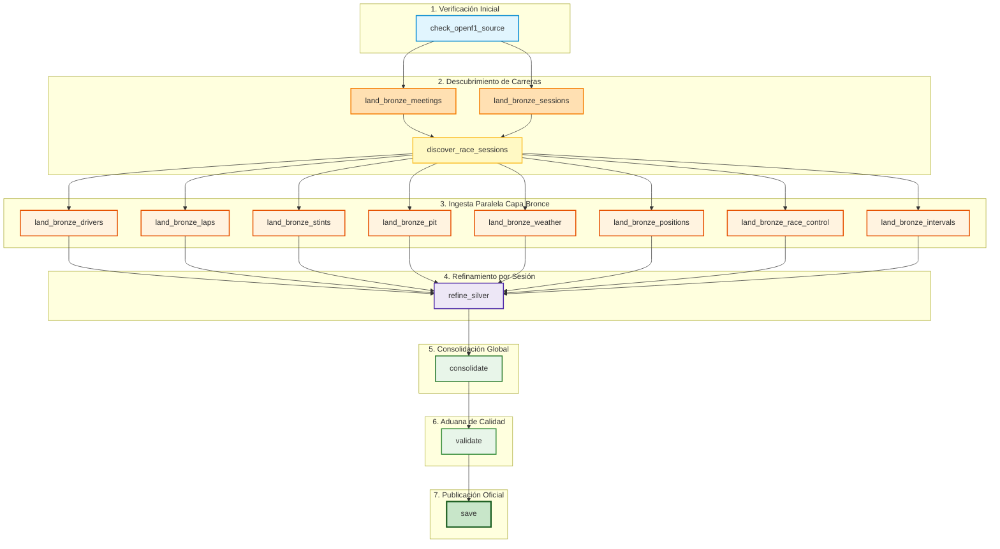

# 🏎️ GUÍA DEFINITIVA PARA LA DEFENSA ORAL – ENTREGA 1 (CIENCIA DE DATOS)
> **Materia:** Ciencia de Datos – Ingeniería en Sistemas de Información (UTN FRM)  
> **Proyecto:** Pipeline de Datos para Estrategia de Neumáticos en Fórmula 1 (`f1-strategy-pipeline`)  
> **Fase del Proyecto:** **Entrega 1: Data Engineering & DataOps Pipeline** (Extracción, Limpieza, Consolidación y Validación).  
> *Nota clave:* Aún **NO** incluye análisis exploratorio avanzado, visualización ni modelos de Machine Learning (eso corresponde a las Entregas 2 y 3).

---

## 🎯 1. La Pregunta del Negocio (El Corazón del Proyecto)

Toda decisión técnica en este pipeline responde exclusivamente a esta pregunta de investigación:

> **«¿Conviene ir a boxes a cambiar el compuesto de neumático en determinada vuelta, dadas las condiciones de carrera, el circuito y el estado actual de los neumáticos de una carrera de Fórmula 1? ¿A qué compuesto de neumáticos conviene cambiar?»**

### ¿Por qué esta pregunta define la arquitectura de datos y los 2 datasets?
Para responder si un piloto debe parar en boxes y qué neumático calzar, necesitamos dos perspectivas analíticas:
1. **Dataset de Vueltas (`f1_silver_dataset.csv`):** Monitorea vuelta a vuelta el rendimiento (`lap_duration`, velocidades), desgaste del neumático (`tyre_age_laps`, `compound`), clima (`air_temperature`, `track_temperature`, `rainfall`) y contexto de carrera (`position`, `gap_to_leader`, `safety_car_active`).
2. **Dataset de Paradas en Boxes (`f1_silver_pit_stops.csv`):** Aislado exclusivamente para las 2.333 paradas reales ocurridas en las 70 carreras, donde se resuelve determinísticamente el neumático entrante (`current_compound`) y el neumático saliente (`new_compound`), junto con las tandas (`stint_in_number` y `new_stint_number`) y duración en boxes (`stop_duration`, `pit_duration`).

---

## ⏱️ 2. El Cronómetro de los 20 Minutos (Estructura de la Exposición)

La cátedra divide los 20 minutos de evaluación en 5 bloques estrictos:

| Minutos | Bloque | Qué sucede | Quién actúa |
|---|---|---|---|
| **0 – 2** | **De qué se trata** | 3 oraciones clave: Pregunta, Fuente, los 2 Datasets y Unidades de Análisis. | Grupo |
| **2 – 7** | **La corrida en Airflow** | Mostrar el grafo en verde, explicando **qué hace cada tarea** y por qué está ahí. | Grupo |
| **7 – 12** | **Los Datasets (CSVs)** | Abrir ambos CSVs y defender los **7 criterios de calidad** con números exactos en mano. | Grupo |
| **12 – 18** | **Preguntas dirigidas** | El docente interroga a integrantes puntuales sobre cualquier tarea o decisión. | Individual |
| **18 – 20** | **Devolución** | Nota y feedback de la cátedra para la Entrega 2. | Docente |

---

## 🎤 3. Minuto 0 a 2: La Apertura Perfecta (Las 3 Oraciones Clave)

Cuando el docente diga «adelante», no abras filminas ni des rodeos teóricos. Di con seguridad:

1. **La Pregunta:**  
   *«Nuestro proyecto busca predecir y evaluar si a un piloto de Fórmula 1 le conviene entrar a boxes a cambiar neumáticos en una vuelta dada según la degradación del neumático, el ritmo de carrera, el clima y los incidentes en pista, y a qué compuesto le conviene cambiar.»*
2. **La Fuente:**  
   *«La fuente de datos es la API pública oficial de telemetría de OpenF1, de la cual consumimos 8 endpoints complementarios que abarcan 70 carreras de las temporadas 2023, 2024 y 2025.»*
3. **Las Unidades de Análisis (Los 2 Datasets):**  
   *«Generamos dos datasets en capa Silver: en el principal (`f1_silver_dataset.csv`, 77.373 filas), una fila es una vuelta de un piloto en un GP; en el dataset de paradas (`f1_silver_pit_stops.csv`, 2.333 filas), una fila representa exclusivamente un ingreso a boxes, incorporando el neumático nuevo (`new_compound`) montado tras la detención.»*

---

## 🕸️ 4. Minuto 2 a 7: Recorrido del Grafo de Airflow (Tarea por Tarea)

Muestras en la pantalla la interfaz web de Airflow, vas a la pestaña **Graph** del DAG `f1_strategy_pipeline` con todas las tareas en **verde (`success`)**, y explicas el flujo en orden:



---

### Explicación detallada de las tareas clave:

#### `refine_silver`
- **Qué hace:** Procesa individualmente cada una de las 70 carreras. Realiza uniones temporales As-Of (clima, posiciones, banderas) y ejecuta `resolve_driver_pits` para vincular cada parada con su tanda saliente. Genera `laps.json`/`laps.csv` y `pit_stops.json`/`pit_stops.csv` por carrera.

#### `consolidate`
- **Qué hace:** Apila los archivos de las 70 carreras y aplica deduplicación estricta sobre las claves primarias de vueltas y de paradas. Escribe los archivos de trabajo intermedios `_consolidado.csv` y `_consolidado_pit_stops.csv`.

#### `validate`
- **Qué hace:** Actúa como el **Firewall de Calidad (DataOps)**. Ejecuta automáticamente los 7 criterios de calidad sobre ambos archivos. Si cualquier chequeo falla, arroja un error y frena el DAG.

#### `save`
- **Qué hace:** Publicación oficial definitiva. Solo se ejecuta si `validate` aprobó al 100%. Copia los temporales a `f1_silver_dataset.csv` y `f1_silver_pit_stops.csv` y guarda copias versionadas con timestamp de fecha.

---

## 📊 5. Minuto 7 a 12: Defensa de los Datasets contra los 7 Criterios

Abres los archivos (`f1_silver_dataset.csv` y `f1_silver_pit_stops.csv`) o ejecutas `python verify_quality_criteria.py`:

| # | Criterio de la Cátedra | Exigencia | Resultado Vueltas (`f1_silver_dataset.csv`) | Resultado Paradas (`f1_silver_pit_stops.csv`) | Cómo se defiende ante el Profesor |
|---|---|---|:---:|:---:|---|
| **1** | **Clave sin duplicados** | `is_unique == True` | **77.373 filas únicas (0 dup)** | **2.333 filas únicas (0 dup)** | En vueltas: `(session_key, driver, lap)`. En pits: `(session_key, driver, lap, pit_index)`. |
| **2** | **Volumen suficiente** | Relevante para modelado | **77.373 filas** | **2.333 paradas** | Abarca las 70 carreras de 2023, 2024 y 2025. |
| **3** | **Ancho suficiente** | $\ge 5$ columnas | **89 columnas** | **93 columnas** | Rendimiento, neumáticos, clima, telemetría y paradas. |
| **4** | **Mezcla de tipos** | Números, categorías, fechas | **Enteros, flotantes, strings, ISO timestamps, booleanos** | **Enteros, flotantes, strings, ISO timestamps, booleanos** | Tipado consistente y validado. |
| **5** | **Nulos conocidos** | Justificados al 100% | **Justificados estructuralmente** | **Justificados estructuralmente** | `stop_duration` es nulo en el dataset de vueltas porque el 98% del tiempo el auto está en pista. En el dataset de pits, todos los registros son paradas. |
| **6** | **Sin columnas vacías** | Ninguna columna 100% nula | **0 columnas vacías (0%)** | **0 columnas vacías (0%)** | Todas las variables aportan datos útiles. |
| **7** | **Unidad de análisis** | Coherente con el objetivo | **1 fila = 1 vuelta de piloto en GP** | **1 fila = 1 parada en boxes en GP** | Permite modelar tanto la degradación continua como la decisión discreta de cambio de compuesto. |

---

## 🧐 6. Minuto 12 a 18: Banco de Preguntas Dirigidas (Preguntas Trampa)

### Pregunta 1: «¿Cómo resolvieron la columna de neumático nuevo (`new_compound`) sin inventar datos?»
**Respuesta:**  
*«Construimos la función determinística `resolve_driver_pits`. Para cada parada $P_j$ de un piloto, encontramos el stint de salida $S_{j+1}$ examinando la secuencia ordenada de tandas y superando las discrepancias de indexación de OpenF1 (donde en 2023 el nuevo stint comenzaba formalmente en la vuelta $L$, y en 2024/2025 en $L+1$). Logramos una tasa de resolución del 100.00% (2.333 de 2.333 paradas) sin asumir cambios arbitrarios ni copiar ciegamente el compuesto anterior.»*

---

### Pregunta 2: «¿Por qué decidieron crear un segundo CSV en lugar de solo agregar la columna al dataset de vueltas?»
**Respuesta:**  
*«Por el principio de integridad de la **Unidad de Análisis**. Si agregábamos `new_compound` en el dataset de vueltas, en el 97% de las vueltas normales esa columna no tendría sentido semántico o estaría duplicando información de stint. Crear `f1_silver_pit_stops.csv` donde cada fila es una parada exacta permite a los modelos de decisión de compuesto entrenar sobre eventos puros de detención, manteniendo el dataset general limpio y tidy para modelar degradación vuelta a vuelta.»*

---

### Pregunta 3: «¿Qué pasa si ejecuto el pipeline de nuevo ahora mismo?»
**Respuesta:**  
*«Es **100% idempotente y reproducible**. En Bronce se detectan los archivos ya descargados sin llamar innecesariamente a la API externa. En Silver se procesan las 70 carreras determinísticamente, se consolidan y deduplican ambos CSVs, `validate` audita los 7 criterios y `save` publica los entregables oficiales. El resultado es byte por byte idéntico.»*

---

## 📋 7. Chuleta Rápida para Repasar 5 Minutos Antes de Entrar

```text
1. PREGUNTA: ¿Cuándo parar en boxes y qué neumático elegir según degradación, clima e incidentes?
2. DOS DATASETS:
   - f1_silver_dataset.csv: 77.373 vueltas (89 columnas) -> 1 fila = 1 vuelta de piloto en GP.
   - f1_silver_pit_stops.csv: 2.333 paradas (93 columnas) -> 1 fila = 1 parada en boxes con new_compound.
3. FUENTE: OpenF1 (70 carreras de 2023, 2024 y 2025).
4. RESOLUCIÓN DE NEW_COMPOUND: 100% resuelto (2.333 / 2.333) vía resolve_driver_pits.
5. CALIDAD: 0 claves duplicadas, 0 columnas vacías, 7/7 criterios superados.
6. CORRIDA AIRFLOW: Bronce -> Refine (laps + pits) -> Consolidate -> Validate -> Save.
7. AS-OF JOINS: Uniones temporales al pasado para evitar Data Leakage.
8. DATAOPS: Validate frena si hay error; Save solo publica si Validate aprueba.
9. ESTADO ACTUAL: Fase 1 (Ingeniería de datos). Modelado y Feature Engineering en la Entrega 2.
```
