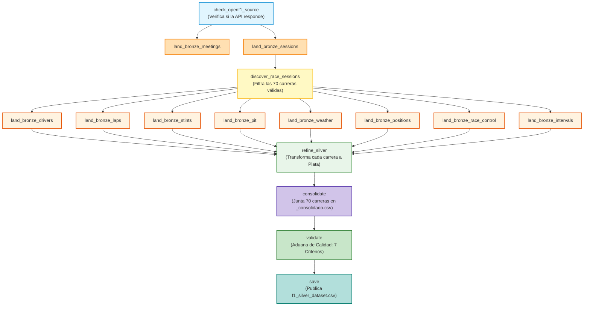

# Guía Definitiva de Exposición y Arquitectura: F1 Strategy Pipeline
**Proyecto Integrador · Entrega 1 · Ciencia de Datos (UTN FRM 2026)**  
**Estructura Canónica:** `Bronce` ──► `refine_silver` ──► `consolidate` ──► `validate` ──► `save`

---

## 1. De qué se trata el proyecto (Explicación Sencilla para Todo Público)

### La analogía del taller mecánico
Imagina que en una carrera de Fórmula 1 tienes sensores en el auto, en las ruedas, en la pista y en el cielo que emiten miles de datos por segundo. 
Para que el equipo en el muro de boxes (*pit wall*) tome decisiones inteligentes (por ejemplo: *«¿conviene cambiar neumáticos en la vuelta 20 o estirar hasta la 25?»*), no pueden ponerse a mirar cables sueltos o planillas desordenadas.

Necesitan una **planta procesadora automática de datos**. Este proyecto es exactamente esa planta:
1. **Receptora (Bronce):** Conecta por internet con la API oficial de telemetría de Fórmula 1 (**OpenF1**) y guarda copias exactas de todo lo que pasó en 70 carreras entre 2023 y 2025.
2. **Mecánica (Refine Silver):** Toma los datos crudos y limpia carrera por carrera las vueltas, las paradas en boxes, el desgaste de las gomas y el clima.
3. **Ensambladora (Consolidate):** Junta las 70 carreras en una sola gran tabla unificada y elimina cualquier registro repetido.
4. **Aduana de Calidad (Validate):** Verifica que la tabla no tenga datos corruptos, rotos o inventados. Si algo está mal, **frena la planta de inmediato**.
5. **Despacho Oficial (Save):** Si y solo si la aduana aprobó todo, publica el archivo final definitivo: `f1_silver_dataset.csv`.

---

## 2. El Grafo de Apache Airflow (La Estructura Idéntica a FIFA)

Siguiendo el diseño pedido por la cátedra en la teoría de *DataOps*:

---

## 3. Explicación de las 4 Tareas Finales (El Núcleo de la Corrección)

A diferencia de versiones preliminares, el DAG ahora tiene **separadas de forma explícita las cuatro responsabilidades de ingeniería**:

### A. `refine_silver` (Refinamiento)
* **¿Qué hace?** Lee los archivos crudos de Bronce y procesa individualmente cada Gran Premio. Por cada carrera genera su propio `laps.csv` y `validation.json` bajo `include/output/silver/season=YYYY/session=XXXX/`.
* **¿Por qué no guarda el dataset final acá?** Porque en ingeniería de software modular, una tarea solo debe encargarse de su ámbito: acá transforma lote por lote sin preocuparse por el producto global.

### B. `consolidate` (Consolidación)
* **¿Qué hace?** Lee los 70 archivos parciales de todas las carreras, los apila en una sola lista gigante y aplica **deduplicación estricta** sobre la clave primaria natural: `(session_key, driver_number, lap_number)`.
* **¿Qué genera?** Escribe un archivo temporal de trabajo llamado:  
  👉 `include/output/silver/_consolidado.csv`.
* **¿Por qué con guión bajo `_consolidado.csv`?** Porque es un archivo intermedio (en tránsito). Aún no sabemos si tiene errores o no, por lo tanto **no debe llamarse todavía con el nombre definitivo**.

### C. `validate` (Validación)
* **¿Qué hace?** Recibe la ruta de `_consolidado.csv` y actúa como un **firewall de calidad de datos**.
* **¿Qué evalúa?** Los 7 criterios exigidos por la cátedra:
  1. Que la clave primaria `(session_key, driver_number, lap_number)` no repita en ninguna de las 77.373 filas.
  2. Que haya más de 1.000 filas (tenemos 77.373).
  3. Que haya más de 5 columnas (tenemos 89).
  4. Que haya mezcla de tipos (enteros, flotantes, textos, fechas y booleanos).
  5. Que los nulos estén identificados y justificados.
  6. Que no haya ninguna columna 100% vacía.
  7. Que la unidad de análisis sea coherente («Una fila es una vuelta de un auto en una carrera»).
* **Regla de oro:** Si un chequeo falla, arroja un error (`raise ValueError`) y **el DAG se detiene en rojo**.

### D. `save` (Guardado y Publicación Oficial)
* **¿Qué hace?** Recibe la ruta del archivo que **ya fue aprobado por la aduana**. Copia `_consolidado.csv` al nombre oficial definitivo:  
  👉 `include/output/silver/f1_silver_dataset.csv`.
* **¿Por qué esta separación es fundamental según el profesor?**  
  Como dice la teoría de la cátedra: *"Esa es toda la diferencia entre validar adentro del pipeline y validar después: si el chequeo falla, `save` nunca corre y el dato malo jamás llega a los consumidores finales"*.

---

## 4. Métricas Reales del Dataset Generado (Para Defender en Clase)

Estos números fueron medidos directamente sobre el archivo final `f1_silver_dataset.csv`:

* **Peso del archivo:** 56.3 Megabytes.
* **Total de Filas:** 77.373 vueltas oficiales.
* **Total de Columnas:** 89 variables.
* **Claves Duplicadas:** 0 duplicados (`is_unique = True`).
* **Columnas 100% vacías:** 0.

### Justificación de los Nulos para el Profesor
Si el profesor pregunta: *«¿Por qué tenés columnas con más de 90% de nulos?»*:
1. `stop_duration` (98.91% de nulos): En una carrera de 60 vueltas, un piloto solo se detiene en boxes 1 o 2 veces. En el 98% de las vueltas restantes, el auto sigue en pista, por lo que **conceptualmente no existe parada**. No es un dato perdido: refleja la realidad de la carrera.
2. `yellow_flag_scope` (96.66% de nulos): Solo tiene valor cuando hay bandera amarilla en un sector. Si la carrera transcurre normal (bandera verde), el campo es nulo.
3. `gap_to_leader` (11.14% de nulos): El piloto que marcha en primer puesto (P1) no tiene brecha contra ningún líder adelante porque el líder es él. Además, en la vuelta 1 aún no se mide brecha acumulada.

---

## 5. El Guion de los 20 Minutos de Exposición

| Minutos | Momento | Lo que debes decir |
|---|---|---|
| **0 – 2** | **De qué se trata** | *«Nuestro proyecto analiza el impacto de la degradación de neumáticos y el clima en la estrategia de paradas en boxes en Fórmula 1. Nuestra fuente es la API oficial OpenF1 (2023 a 2025). Una fila de nuestro dataset es una vuelta completada o intentada por un piloto en una carrera de Gran Premio.»* |
| **2 – 7** | **La corrida** | Muestras la pantalla de Airflow con las cajas en verde: *«El flujo verifica la API, baja 8 endpoints a la capa Bronce reusando archivos locales para no saturar el Rate Limit, refina en Plata cada carrera, consolida las 70 carreras eliminando duplicados en `_consolidado.csv`, valida los 7 criterios de calidad, y finalmente `save` publica el entregable oficial.»* |
| **7 – 12** | **El dataset** | Abres el archivo y cantas los números: *«Son 77.373 filas y 89 columnas. La clave compuesta `(session_key, driver_number, lap_number)` tiene 0 duplicados. Solo hay nulos en eventos esporádicos como paradas en boxes o banderas amarillas. La variable objetivo a predecir es `current_compound` o `pit_stop`.»* |
| **12 – 18** | **Preguntas dirigidas** | Respondes con seguridad usando los conceptos explicados arriba. |
| **18 – 20** | **Devolución** | Cierre y felicitaciones del docente.
