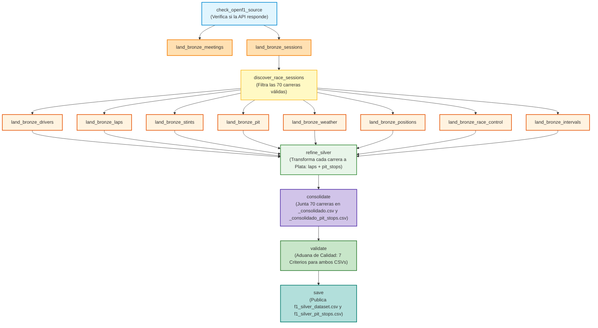

# Guía Definitiva de Exposición y Arquitectura: F1 Strategy Pipeline
**Proyecto Integrador · Entrega 1 · Ciencia de Datos (UTN FRM 2026)**  
**Estructura Canónica:** `Bronce` ──► `refine_silver` ──► `consolidate` ──► `validate` ──► `save`

---

## 1. De qué se trata el proyecto (Explicación Sencilla para Todo Público)

### La analogía del taller mecánico
Imagina que en una carrera de Fórmula 1 tienes sensores en el auto, en las ruedas, en la pista y en el cielo que emiten miles de datos por segundo. 
Para que el equipo en el muro de boxes (*pit wall*) tome decisiones inteligentes (por ejemplo: *«¿conviene cambiar neumáticos en la vuelta 20 o estirar hasta la 25? ¿A qué compuesto cambiar?»*), no pueden ponerse a mirar cables sueltos o planillas desordenadas.

Necesitan una **planta procesadora automática de datos**. Este proyecto es exactamente esa planta:
1. **Receptora (Bronce):** Conecta por internet con la API oficial de telemetría de Fórmula 1 (**OpenF1**) y guarda copias exactas de todo lo que pasó en 70 carreras entre 2023 y 2025.
2. **Mecánica (Refine Silver):** Toma los datos crudos y procesa carrera por carrera tanto la telemetría de vueltas como los eventos de parada en boxes, vinculando stints de entrada y salida determinísticamente.
3. **Ensambladora (Consolidate):** Junta las 70 carreras en dos tablas unificadas en tránsito (`_consolidado.csv` y `_consolidado_pit_stops.csv`) y elimina cualquier registro repetido.
4. **Aduana de Calidad (Validate):** Verifica que ambas tablas cumplan rigurosamente los 7 criterios de calidad de datos. Si algo está mal, **frena la planta de inmediato**.
5. **Despacho Oficial (Save):** Si y solo si la aduana aprobó todo, publica los archivos finales definitivos:  
   - `f1_silver_dataset.csv` (Dataset de Vueltas)  
   - `f1_silver_pit_stops.csv` (Dataset de Paradas en Boxes con `new_compound`).

---

## 2. El Grafo de Apache Airflow (La Estructura Idéntica a FIFA)

Siguiendo el diseño pedido por la cátedra en la teoría de *DataOps*:

---

## 3. Explicación de las 4 Tareas Finales (El Núcleo de la Corrección)

A diferencia de versiones preliminares, el DAG ahora tiene **separadas de forma explícita las cuatro responsabilidades de ingeniería**:

### A. `refine_silver` (Refinamiento)
* **¿Qué hace?** Lee los archivos crudos de Bronce y procesa individualmente cada Gran Premio. Por cada carrera genera su propio `laps.csv`, `pit_stops.csv` y `validation.json` bajo `include/output/silver/season=YYYY/session=XXXX/`.
* **Resolución de Paradas (`resolve_driver_pits`):** Vincula determinísticamente cada parada en boxes con el stint saliente y resuelve `new_compound` al 100% (superando las diferencias de indexación de stints de OpenF1 entre 2023 y 2024/2025).
* **¿Por qué no guarda el dataset final acá?** Porque en ingeniería de software modular, una tarea solo debe encargarse de su ámbito: transforma sesión a sesión sin acoplarse al producto global.

### B. `consolidate` (Consolidación)
* **¿Qué hace?** Lee los archivos parciales de las 70 carreras, los unifica y aplica **deduplicación estricta sobre las claves primarias naturales**:
  - Para Vueltas: `(session_key, driver_number, lap_number)`.
  - Para Paradas: `(session_key, driver_number, lap_number, pit_index)`.
* **¿Qué genera?** Escribe dos archivos temporales de trabajo:  
  👉 `include/output/silver/_consolidado.csv`  
  👉 `include/output/silver/_consolidado_pit_stops.csv`
* **¿Por qué con guión bajo `_`?** Porque son archivos intermedios (en tránsito). Aún no sabemos si tienen errores o no, por lo tanto **no deben llamarse todavía con el nombre definitivo**.

### C. `validate` (Validación)
* **¿Qué hace?** Recibe las rutas de `_consolidado.csv` y `_consolidado_pit_stops.csv` y actúa como un **firewall de calidad de datos (DataOps)**.
* **¿Qué evalúa?** Los 7 criterios exigidos por la cátedra para ambos datasets:
  1. Que las claves primarias no tengan duplicados (`is_unique == True`).
  2. Que el volumen sea suficiente (>1.000 filas en vueltas, >100 en pits).
  3. Que haya más de 5 columnas útiles (89 en vueltas, 93 en pits).
  4. Que haya mezcla de tipos (enteros, flotantes, strings, fechas y booleanos).
  5. Que los nulos estén identificados y justificados al 100%.
  6. Que no haya ninguna columna 100% vacía.
  7. Que la unidad de análisis sea coherente («1 fila = 1 vuelta» y «1 fila = 1 parada en boxes»).
* **Regla de oro:** Si un chequeo falla, arroja un error (`raise ValueError`) y **el DAG se detiene en rojo**.

### D. `save` (Guardado y Publicación Oficial)
* **¿Qué hace?** Recibe las rutas de los archivos que **ya fueron aprobados por la aduana**. Copia los consolidados a sus nombres oficiales definitivos:  
  👉 `include/output/silver/f1_silver_dataset.csv`  
  👉 `include/output/silver/f1_silver_pit_stops.csv`  
  y genera los backups versionados por fecha (`f1_silver_{ds}.csv` y `f1_silver_pit_stops_{ds}.csv`).
* **¿Por qué esta separación es fundamental según el profesor?**  
  Como dice la teoría de la cátedra: *"Esa es toda la diferencia entre validar adentro del pipeline y validar después: si el chequeo falla, `save` nunca corre y el dato malo jamás llega a los consumidores finales"*.

---

## 4. Métricas Reales de los Datasets Generados (Para Defender en Clase)

Estos números fueron medidos directamente sobre los archivos finales:

### A. Dataset Principal de Vueltas (`f1_silver_dataset.csv`)
* **Total de Filas:** 77.373 vueltas oficiales.
* **Total de Columnas:** 89 variables.
* **Claves Duplicadas:** 0 duplicados (`is_unique = True`).
* **Columnas 100% vacías:** 0.

### B. Dataset de Paradas en Boxes (`f1_silver_pit_stops.csv`)
* **Total de Filas:** 2.333 paradas en boxes reales.
* **Total de Columnas:** 93 variables.
* **Filas de no-pits:** 0 (100% son paradas efectivas).
* **Claves Duplicadas:** 0 duplicados.
* **Tasa de resolución de `new_compound`:** 2.333 / 2.333 (**100.00%**).
* **Distribución de transiciones de neumáticos más frecuentes:**
  - `MEDIUM` ➔ `HARD`: 710 paradas (30.43%)
  - `HARD` ➔ `HARD`: 288 paradas (12.34%)
  - `HARD` ➔ `MEDIUM`: 275 paradas (11.79%)
  - `MEDIUM` ➔ `MEDIUM`: 188 paradas (8.06%)
  - `SOFT` ➔ `MEDIUM`: 148 paradas (6.34%)

### Justificación de los Nulos para el Profesor
Si el profesor pregunta: *«¿Por qué tenés columnas con más de 90% de nulos en el dataset de vueltas?»*:
1. `stop_duration` (98.91% de nulos en `f1_silver_dataset.csv`): En una carrera de 60 vueltas, un piloto solo se detiene en boxes 1 o 2 veces. En el 98% de las vueltas restantes, el auto sigue en pista, por lo que **conceptualmente no existe parada**. En el segundo dataset (`f1_silver_pit_stops.csv`), esta columna no tiene ese sesgo porque solo contiene paradas.
2. `yellow_flag_scope` (96.66% de nulos): Solo tiene valor cuando hay bandera amarilla en un sector. Si la carrera transcurre normal (bandera verde), el campo es nulo.
3. `gap_to_leader` (11.14% de nulos): El piloto que marcha en primer puesto (P1) no tiene brecha contra ningún líder adelante porque el líder es él. Además, en la vuelta 1 aún no se mide brecha acumulada.

---

## 5. El Guion de los 20 Minutos de Exposición

| Minutos | Momento | Lo que debes decir |
|---|---|---|
| **0 – 2** | **De qué se trata** | *«Nuestro proyecto analiza el impacto de la degradación de neumáticos y el clima en la estrategia de paradas en boxes en Fórmula 1. Nuestra fuente es la API oficial OpenF1 (2023 a 2025). Generamos dos datasets complementarios: uno donde cada fila es una vuelta de carrera (77.373 filas), y un segundo dataset solicitado por la cátedra donde cada fila es exclusivamente una parada en boxes (2.333 filas), incorporando el neumático nuevo colocado tras la parada.»* |
| **2 – 7** | **La corrida** | Muestras la pantalla de Airflow con las cajas en verde: *«El flujo verifica la API, baja 8 endpoints a la capa Bronce reusando archivos locales, refina en Plata cada carrera generando laps y pit_stops, consolida las 70 carreras eliminando duplicados en `_consolidado.csv` y `_consolidado_pit_stops.csv`, valida los 7 criterios de calidad en ambos, y finalmente `save` publica los entregables oficiales certificados.»* |
| **7 – 12** | **El dataset** | Abres los archivos y cantas los números: *«Son 77.373 filas en vueltas (89 columnas) y 2.333 paradas en boxes (93 columnas). Ambas claves primarias tienen 0 duplicados. El 100% de las paradas tienen resuelto su `new_compound`. Cumplimos los 7 criterios de calidad al 100%.»* |
| **12 – 18** | **Preguntas dirigidas** | Respondes con seguridad usando los conceptos explicados arriba. |
| **18 – 20** | **Devolución** | Cierre y felicitaciones del docente. |
